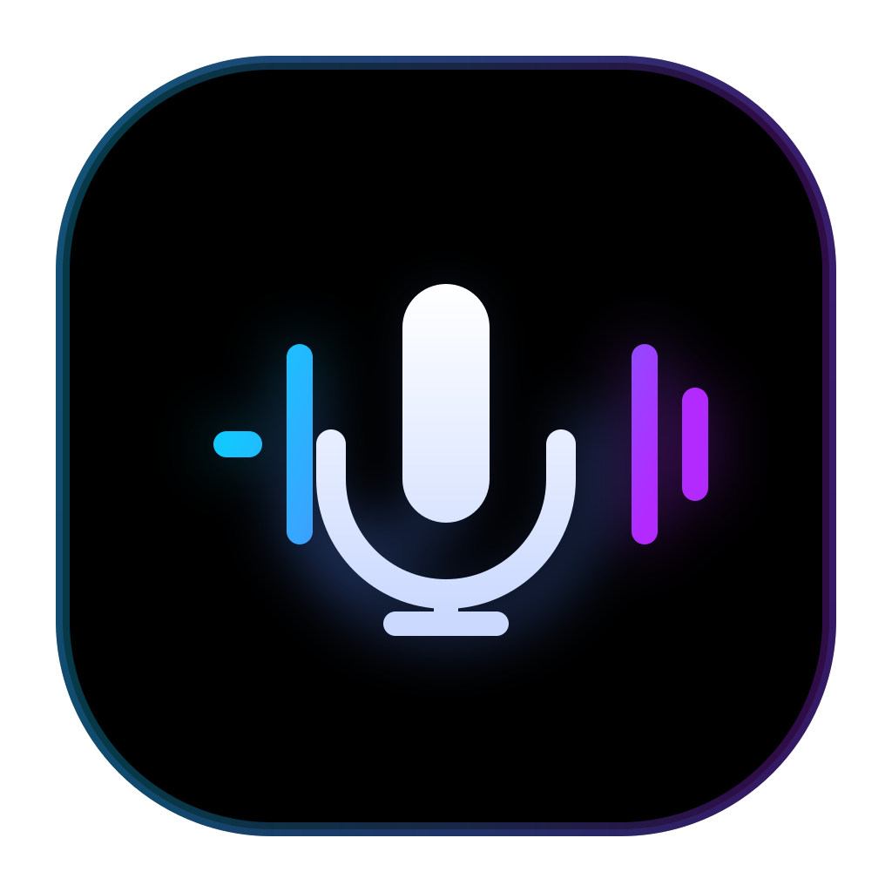
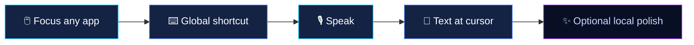

<table>
<tr>
<td align="center" style="background: linear-gradient(160deg, #1a2d5c 0%, #142343 35%, #0a1228 70%, #080F25 100%); border: 1px solid #5789FF40; border-radius: 24px; padding: 52px 32px 44px; box-shadow: 0 24px 80px #080F2566;">

<table cellpadding="0" cellspacing="0" style="margin: 0 auto 20px;">
<tr>
<td align="center" style="padding: 6px; border-radius: 52px; background: linear-gradient(135deg, #16C9FF55, #5789FF44, #A42DFF55);">

</td>
</tr>
</table>

<h1 style="margin: 0 0 6px; font-size: 3em; letter-spacing: -0.03em; line-height: 1.1;">
  Voxen
</h1>

  Speak anywhere you type.

  A lightweight <strong style="color: #E8EEFF;">Windows dictation</strong> app — global shortcut, local speech recognition, and your words land in whatever already has focus.

  
  &nbsp;
  
  &nbsp;
  
  &nbsp;
  

</td>
</tr>
</table>

 

<table width="100%">
<tr>
<td align="center" width="32%" style="padding: 18px 14px; border-radius: 16px; background: linear-gradient(180deg, #142343 0%, #101a35 100%); border: 1px solid #16C9FF35;">
  
🎙️

  <strong style="color: #16C9FF;">Hold or toggle</strong> 
  Your shortcut, your mode
</td>
<td width="2%"></td>
<td align="center" width="32%" style="padding: 18px 14px; border-radius: 16px; background: linear-gradient(180deg, #142343 0%, #101a35 100%); border: 1px solid #5789FF35;">
  
🔒

  <strong style="color: #5789FF;">On-device STT</strong> 
  Audio stays on your machine
</td>
<td width="2%"></td>
<td align="center" width="32%" style="padding: 18px 14px; border-radius: 16px; background: linear-gradient(180deg, #142343 0%, #101a35 100%); border: 1px solid #A42DFF35;">
  
⚡

  <strong style="color: #C77DFF;">Tray-first</strong> 
  Minimal UI until you need settings
</td>
</tr>
</table>

 

---

## How it works

<table width="100%">
<tr>
<td width="50%" valign="top" style="padding: 8px 20px 8px 0;">

### Getting started

1. Put the cursor where you want text.
2. **Hold** the shortcut to talk, or **toggle** it on and off in Settings.
3. When you stop, Voxen inserts the transcript there.

Optional cleanup can lightly polish wording with a small **local** model — **off by default**.

</td>
<td width="50%" valign="top" style="padding: 8px 0 8px 24px; border-left: 2px solid #5789FF28;">

### Scope

Voxen is intentionally small: shortcut dictation, local speech recognition, and a few optional tweaks — not accounts, sync, saved history, or a full voice assistant.

| | |
|---|---|
| ✅ | Global hotkey, tray, local models |
| ❌ | Cloud transcription, voice commands, history |

**Windows only** for now. Microphone, shortcut, and model setup live in **Settings**.

</td>
</tr>
</table>

---

<table width="100%">
<tr>
<td align="center" width="33%" style="padding: 22px 12px; vertical-align: top; border-radius: 14px; background: #F8FAFF;">

⚡

**Fast**

Global shortcut, minimal chrome, tray when you need it

</td>
<td width="2%"></td>
<td align="center" width="33%" style="padding: 22px 12px; vertical-align: top; border-radius: 14px; background: #F8FAFF;">

🔐

**Private**

Recognition on your machine — no cloud transcription

</td>
<td width="2%"></td>
<td align="center" width="33%" style="padding: 22px 12px; vertical-align: top; border-radius: 14px; background: #F8FAFF;">

🎯

**Focused**

Dictation into the app that already has focus

</td>
</tr>
</table>

 

<table>
<tr>
<td align="center" style="padding: 16px 28px; border-radius: 14px; background: linear-gradient(135deg, #142343 0%, #1a2d5c 100%); border: 1px solid #5789FF33;">
<strong style="color: #16C9FF;">Goal</strong> — fast, private voice input with almost no UI. Settings and a tray icon when you need them; otherwise it stays out of the way.
</td>
</tr>
</table>

 

  

Svelte 5 · Tauri 2 · Rust · Parakeet TDT v3 · NeMo-Speech.cpp

